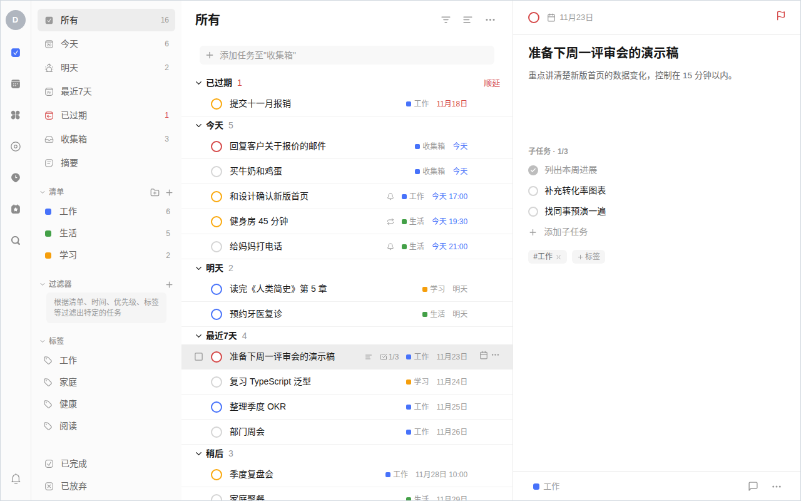
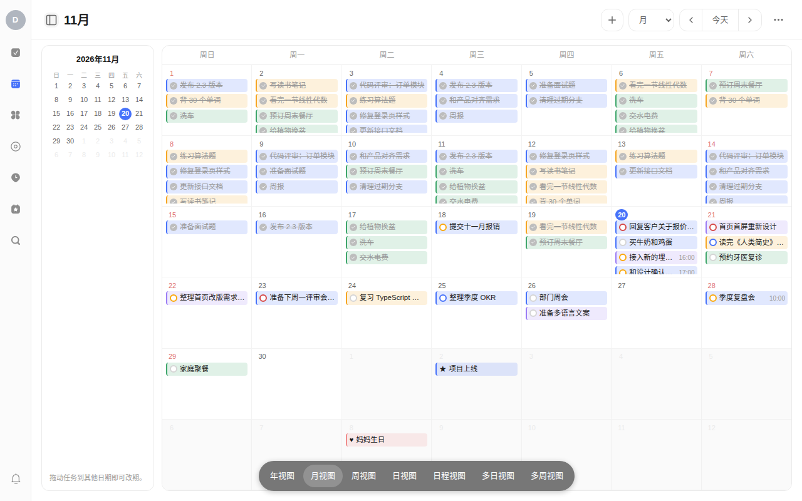
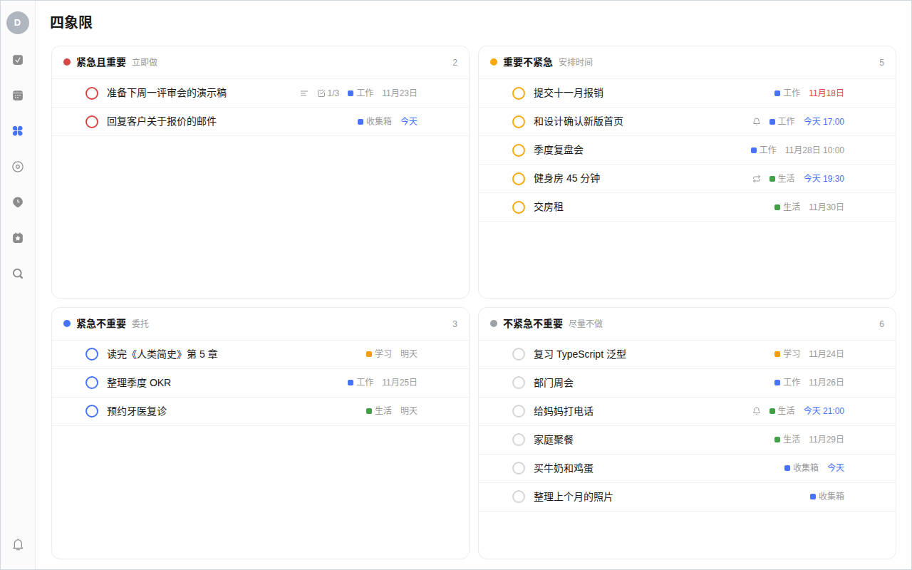
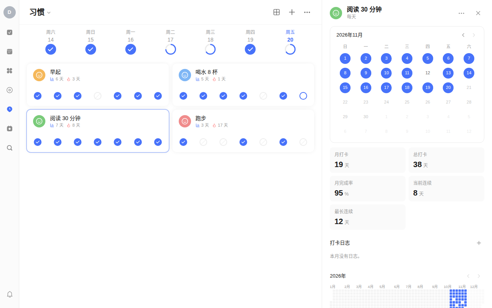
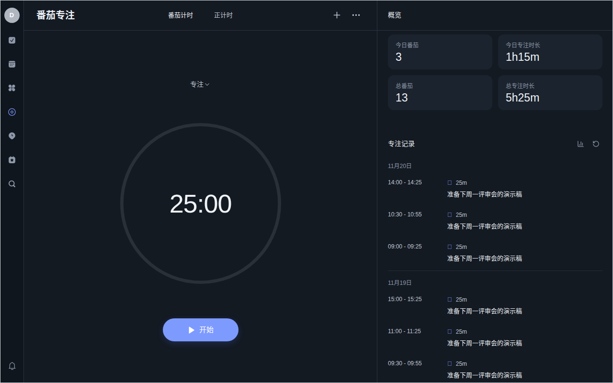
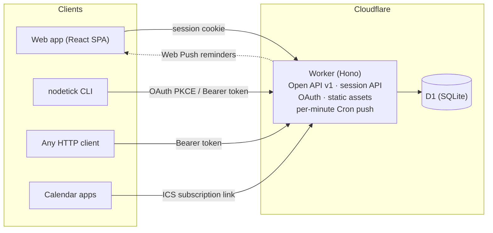

# NodeTick 🐘

[中文](README.md) | English

**A self-hosted, TickTick-compatible task server that runs on Cloudflare, with a web app and a command-line tool.**

What [NodeWarden](https://github.com/shuaiplus/nodewarden) is to Bitwarden, NodeTick is to TickTick: your tasks, lists, habits and focus data live in your own Cloudflare account.

- **TickTick Open API v1 compatible**: implements the core endpoints used by the official [ticktick-cli](https://www.npmjs.com/package/@ticktick/ticktick-cli), plus extensions such as a trash and countdown writes
- **Web app included**: a TickTick-style React app covering tasks, calendar, Eisenhower Matrix, habits, focus, countdowns and browser push notifications
- **Companion CLI**: `nodetick` mirrors the official CLI's commands and can point at your own server
- **No ops**: built on Workers + D1, so there are no servers or databases to look after and no bandwidth fees; the free plan is enough



[Features](#features) · [Architecture](#architecture) · [Deployment](#deployment) · [CLI](#cli) · [API](#api) · [Security model](#security-model) · [Local development](#local-development) · [Roadmap](#roadmap)

## Features

- **Tasks**: smart lists (All / Today / Tomorrow / Next 7 Days / Inbox), lists and groups, tags, filters; list / Kanban / timeline views (the timeline lists undated tasks underneath; click one to give it a date); Kanban columns can be renamed, deleted and quick-added to; pinning and bulk actions; Completed, Abandoned and Trash (soft delete; restore or delete permanently)
- **Search**: every word has to match the title, description, a subtask or a tag (`#tag` matches tags only); hits are highlighted, with the description or subtask they came from; multi-select filters for list, tag, date (today / tomorrow / this week / next 7 days / this month / overdue / no date / custom), priority, type (task / note) and status (open / completed / won't do); recent searches; save the keywords and filters as a filter in one step
- **Calendar**: Year / Month / Week / Day / Schedule / 3-day / 2-week views and a mini month calendar; drag to reschedule, or click the `+` in a cell to create a task on that date
- **Eisenhower Matrix**: sorts tasks into four quadrants by priority
- **Habits**: a 7-day check-in strip and streaks
- **Focus**: a Pomodoro timer and weekly stats
- **Countdowns**: count down to the dates that matter, with monthly or yearly repeats; a monthly repeat set on the 29th–31st reminds you on the last day of shorter months, and a yearly repeat on February 29 reminds you on February 28 in common years
- **Statistics**: the **Statistics** page in the avatar menu shows, for the last 7 days / 30 days / 12 weeks / 12 months, completed tasks (compared with the previous period), the completion rate of tasks due, the on-time rate and what is overdue now; a completion trend, a year of completions as a calendar heat map, and breakdowns by list, tag, priority, weekday and time of day; narrow it to one list, and switch any chart to a table
- **Summary**: a digest of tasks that match your criteria (in progress, see the [Roadmap](#roadmap))
- **Notifications**: Web Push reminders for tasks, habits and countdowns; switched on per device, so turning them off on one device leaves the others alone; push text follows each device's UI language (Chinese / English); per-category switches, a reminder time for all-day items and test notifications; clicking a notification opens the task (requires [enabling browser notifications](#enable-browser-notifications-optional) first)
- **Account & data**: change your password; admins add and delete users and reset passwords on the **User management** page; JSON backup and restore; import lists, folders, Kanban columns and tasks from a TickTick backup (see [Migrating from TickTick](#migrating-from-ticktick)); import lists and tasks from Microsoft To Do (requires [setting up a Microsoft app](#enable-the-microsoft-to-do-import-optional) first); a calendar subscription link (ICS, works with Google Calendar, Apple Calendar and others); API token management
- **General**: Chinese and English UI (follows the browser language; switch it from the avatar menu); Blue / Violet / Green / Dark themes; hide the feature modules and smart lists you don't use in Settings; on phones and other narrow screens, the task sidebar moves into a drawer and task details open full-screen

| Calendar | Eisenhower Matrix |
| :---: | :---: |
|  |  |
| **Habits** | **Focus (dark theme)** |
|  |  |

The screenshots show the Chinese UI with demo tasks and habits. The app follows your browser language, so English browsers get the English UI.

### Quick add and everyday actions

Type tags, dates and priorities straight into the quick-add box. A recognized date is highlighted in blue; clicking it, or pressing Backspace at its edge, only cancels the recognition and keeps the text. Tasks added in Today, Tomorrow or Next 7 Days go to the Inbox with that date preset; a date typed in the input takes precedence.

| Input | Effect |
| --- | --- |
| `#tag` | Add a tag |
| `today` `tomorrow` `next week` `friday` `fri` `9/5` (month/day; an optional `~` prefix is allowed) | Set the date; a month and day that have already passed roll over to next year. The Chinese UI uses `今天` `明天` `后天` `下周` `周五` `9月5日` instead |
| `!3` `!high` `!高` | High priority (`!2` / `!medium` for medium, `!1` / `!low` for low, `!0` / `!none` for none) |

In the task list you can also:

- Postpone all overdue tasks in one click; hover over a task row to set its date quickly
- Duplicate, move or delete tasks from the row menu, and undo mistakes from the toast
- Edit the description, subtasks, tags and comments in the detail panel; task rows show badges for reminders, repeats and descriptions

### Migrating from TickTick

1. In TickTick, open **Settings → Account → Backup & Import** and generate a backup. You get a `.csv` file.
2. On NodeTick's **API tokens** page (`/app/tokens`), click **Import from TickTick** under **Backup & restore**, choose the file and pick the lists to import. The browser parses the file, then imports it list by list.

- Folders become list groups; Kanban lists keep their columns; TickTick's inbox goes into the Inbox.
- Subtasks keep their parents and checklist items become subtasks; tags, descriptions, priorities, repeat rules and start/due times (all-day and multi-day included) come along. Reminders on all-day tasks become a number of days ahead, at your all-day reminder time.
- Completed and won't-do tasks are skipped unless you tick the box. TickTick backups contain no habits, focus records, comments or attachments.
- Importing the same backup again only adds new tasks; tasks imported earlier are never overwritten or duplicated, even if you changed or deleted them in NodeTick.
- TickTick doesn't document the backup format, so the importer reads columns by name and tolerates missing ones; rows it can't read are reported and skipped.

## Architecture



The web app and the CLI call the same `/open/v1/*` endpoints; the web app authenticates with a session cookie, so there is no token to configure. The Worker also serves the web app's static assets (with SPA fallback); `/api/*`, `/oauth/*` and `/open/v1/*` are always handled by Worker code. The OAuth consent page used by `nodetick auth login` is rendered on the server.

| Directory | Contents |
| --- | --- |
| `worker/` | Cloudflare Worker: Open API v1, `/api/*` session endpoints, OAuth PKCE, scheduled push (Hono + D1) |
| `webapp/` | React SPA, served by the Worker as static assets (Vite + Tailwind + zustand) |
| `cli/` | `nodetick` CLI (commander; commands mirror ticktick-cli) |
| `tests/` | E2E suite: tests a real server through the CLI |

## Deployment

You need a Cloudflare account (the free plan is fine), Node.js 22+ and pnpm (`corepack enable pnpm` is recommended; it uses the pnpm version pinned in `package.json`). The D1 schema is created automatically on the first request, so there are no tables to create by hand.

### Deploy from the command line (about 2 minutes)

**1. Clone and install dependencies**

```bash
git clone https://github.com/Windyskr/nodetick.git
cd nodetick
pnpm install
```

**2. Log in to Cloudflare and deploy**

```bash
pnpm --filter worker exec wrangler login
pnpm run deploy     # builds the web app, then deploys the Worker and static assets
```

`pnpm --filter worker exec wrangler …` runs the project's own Wrangler inside `worker/`, so it picks up `worker/wrangler.toml` automatically. All Wrangler commands below are written this way.

On the first deploy, Wrangler creates a D1 database named `nodetick-db` (or uses the existing one if your account already has a database with that name). You don't need to fill in a `database_id`.

> [!TIP]
> A database's location is fixed when it is created and can't be changed later; an automatically created one goes to the region nearest the network you deploy from. Every query is a round trip to the database, so distance shows (from Tokyo, a database in western North America costs about 130 ms per query). If your users are mostly in Asia, create it yourself before the first deploy: `pnpm --filter worker exec wrangler d1 create nodetick-db --location apac` (Asia-Pacific lands in Hong Kong). See the [D1 docs](https://developers.cloudflare.com/d1/configuration/data-location/) for other locations.

**3. Set the session secret**

```bash
pnpm --filter worker exec wrangler secret put SESSION_SECRET
```

When prompted, paste a random string of at least 32 characters (`openssl rand -hex 32` generates one). Registration and login don't work until it is set. Secrets take effect as soon as they are written, with no redeploy needed.

**4. Open the app**

Visit `https://nodetick.<your-subdomain>.workers.dev`. The first user to register becomes the admin. Public registration then closes automatically and the admin adds accounts on the **User management** page, so register right after deploying.

> [!NOTE]
> `*.workers.dev` is unreachable on some networks (mainland China, for example). If needed, add a custom domain to the Worker in the Cloudflare dashboard.

### Deploy from the Cloudflare dashboard

1. Fork this repository and import your fork under Workers & Pages with these build settings:
   - Worker name: `nodetick` (must match `name` in `wrangler.toml`)
   - Build command: `pnpm install`
   - Deploy command: `pnpm run deploy`
2. The first deploy creates the D1 database `nodetick-db` automatically. If that fails, create a database with the same name in the dashboard, then deploy again.
3. Once deployed, add the secret `SESSION_SECRET` (a random string of 32+ characters) in the Worker's settings.

### Enable browser notifications (optional)

**1. Generate a VAPID key pair**

```bash
pnpm --filter worker generate:vapid
```

**2. Set the public key and contact**

In the Worker's settings in the Cloudflare dashboard, add the variables `VAPID_PUBLIC_KEY` (the public key from the output) and `VAPID_SUBJECT` (such as `mailto:admin@example.com`). Alternatively, put them under `[vars]` in `worker/wrangler.toml` and run `pnpm run deploy` again:

```toml
[vars]
VAPID_PUBLIC_KEY = "<public key from the output>"
VAPID_SUBJECT = "mailto:admin@example.com"
```

**3. Store the private key only as a secret**

```bash
pnpm --filter worker exec wrangler secret put VAPID_PRIVATE_KEY
```

Never write the private key into a file or commit it to the repository. Once everything is configured, a Cron Trigger scans for due reminders every minute and pushes them to subscribed browsers via Web Push.

### Enable the Microsoft To Do import (optional)

Microsoft To Do has no export, so the import reads lists and tasks through Microsoft Graph, which needs a Microsoft Entra app registration. Sign-in uses the device code flow: the web app shows a code that the user enters on Microsoft's sign-in page. The flow needs no redirect URI, so one app registration can serve any number of NodeTick deployments.

**1. Register an app**

1. Sign in to the [Microsoft Entra admin center](https://entra.microsoft.com) and go to **App registrations** → **New registration**. Since June 2024, new apps must be registered in a directory (tenant); with only a personal account and no directory, sign up for a free Azure account, which comes with a default directory.
2. Pick any name (such as `NodeTick`); under **Supported account types** choose **Accounts in any organizational directory and personal Microsoft accounts**; leave the redirect URI empty.
3. Under **Authentication**, set **Allow public client flows** to **Yes** and save.
4. Under **API permissions**, add the Microsoft Graph delegated permission `Tasks.Read`. Users can consent to it themselves; no admin consent is needed.

**2. Set the client ID**

Copy the **Application (client) ID** from the app's overview page and add it as the variable `MS_TODO_CLIENT_ID` in the Cloudflare dashboard, or put it under `[vars]` in `worker/wrangler.toml` and run `pnpm run deploy` again. A client ID is not a secret.

For personal accounts only, set `MS_TODO_TENANT` to `consumers` (the app's account types must include personal accounts); for work or school accounts only, set it to `organizations` or a tenant ID. Some organizations block device code sign-in.

**3. Import**

On the web app's **API tokens** page (`/app/tokens`), click **Import from Microsoft To Do** under **Backup & restore**, sign in, and pick the lists to import. What gets imported:

- Each list becomes a list; To Do's built-in **Tasks** list goes into the Inbox. The **Flagged email** list (flagged Outlook mail) is unchecked by default.
- Steps become subtasks; notes, categories (as tags), importance (as high priority), due dates and repeat rules come along. Completed tasks are left out unless you tick the box.
- Due dates become all-day tasks. A reminder on the due day, or on a task without a due date, makes the task a timed task at the reminder time that reminds on time; a reminder before the due day keeps the task all-day and becomes an offset from the **All-day reminder time**.
- Attachments and list groups are not imported (Graph does not expose list groups).
- The import only asks for read access and never changes Microsoft To Do. Importing again only adds new tasks: tasks imported before are never overwritten or duplicated, even if you have edited them in NodeTick or moved them to the trash.

### Configuration

| Name | Type | Required | Description |
| --- | --- | --- | --- |
| `SESSION_SECRET` | Secret | Yes | Random string of 32+ characters used to sign the session's CSRF tokens |
| `VAPID_PUBLIC_KEY` | Variable | No | Web Push public key |
| `VAPID_SUBJECT` | Variable | No | Contact for the push sender (`mailto:` or `https:`) |
| `VAPID_PRIVATE_KEY` | Secret | No | Web Push private key |
| `MS_TODO_CLIENT_ID` | Variable | No | Client ID of a Microsoft Entra app; turns on the Microsoft To Do import |
| `MS_TODO_TENANT` | Variable | No | Tenant for Microsoft sign-in: `common` (default), `consumers`, `organizations` or a tenant ID |

Variables added in the Worker's settings in the Cloudflare dashboard take effect immediately and are kept on later deploys (`wrangler.toml` enables `keep_vars`). Variables under `[vars]` in `worker/wrangler.toml` take effect on the next deploy and override dashboard variables of the same name. Set secrets with `pnpm --filter worker exec wrangler secret put <NAME>`.

## CLI

`@nodetick/cli` is not published to npm yet, so install it from source:

```bash
pnpm --filter cli build
pnpm add -g ./cli    # provides the nodetick command globally; or skip this and run node cli/dist/index.js
```

`pnpm add -g` needs pnpm's global bin directory on your `PATH`; run `pnpm setup` once before using it for the first time.

**Log in**

```bash
nodetick auth login --server https://nodetick.example.workers.dev   # OAuth in the browser
nodetick auth token <token> --server https://...                    # no browser: use a token created in the web app
nodetick auth status
```

Create tokens on the **API tokens** page of the web app (`/app/tokens`).

**Common commands**

```bash
nodetick project create --name Work
nodetick task create --title "Buy milk" --project <projectId> --tags groceries
nodetick task search milk --status 0
nodetick habit checkin <habitId> --stamp 20260831 --value 5
nodetick focus list --from "2026-08-01T00:00:00+0000" --to "2026-08-30T23:59:59+0000" --type pomodoro
nodetick countdown create --name "Launch day" --date 2026-12-31
nodetick countdown update <countdownId> --date 2027-01-01
nodetick countdown delete <countdownId>

nodetick backup export                    # export everything to nodetick-backup-<today>.json
nodetick backup export ./my-backup.json   # choose the output path
nodetick backup import ./my-backup.json   # merge by id without deleting existing data
```

- Most commands accept `--json` to print the raw API JSON.
- The server URL and token are saved in `~/.config/nodetick/config.json` (mode 600); the `NODETICK_SERVER` / `NODETICK_TOKEN` environment variables take precedence, which suits CI.
- See `nodetick --help` and `nodetick <command> --help` for all options.

### Compatibility with ticktick-cli

`nodetick` mirrors the official ticktick-cli commands, and the server implements the Open API v1 endpoints behind the following commands:

- **Tasks**: get / create / update / complete / delete / move / completed / filter / search; add, delete and list comments; subtasks, parent and child tasks, tags, reminders, repeat rules, focus summaries
- **Projects (lists)**: create, read, update and delete; `data` (project + tasks + Kanban columns); groups (folders); Kanban columns
- **Tags**: list / create (tags used on tasks are registered automatically)
- **Habits**: get / list / create / update / checkin (upsert by date) / checkins range queries
- **Focus**: get / list (time range of at most 30 days) / create / delete; both Pomodoro and stopwatch records
- **Countdowns**: list / create / update / delete (the official API only has list; writes are a NodeTick extension)

Authentication works the same way as the official CLI: OAuth PKCE (`nodetick auth login`) and manual tokens (`nodetick auth token`).

These official commands are not implemented yet (compared with ticktick-cli 0.1.16): preference get; task complete-batch, assign, unassign; project members; tag update, rename, delete; habit section list; focus update; calendar account list, calendar event query.

## API

The base path is `{server}/open/v1`, and the endpoints follow the [TickTick Open API v1](https://developer.ticktick.com/api#/openapi). Authenticate with `Authorization: Bearer <ntk_…>` or the web app's session cookie. Endpoints marked ★ are NodeTick extensions.

<details>
<summary><b>Tasks</b></summary>

| Method | Path | Description |
| --- | --- | --- |
| GET | `/project/{projectId}/task/{taskId}` | Get a task |
| POST | `/task` | Create a task |
| POST | `/task/{taskId}` | Update a task (can also toggle `status` 0 ↔ 2) |
| POST | `/project/{projectId}/task/{taskId}/complete` | Complete a task |
| DELETE | `/project/{projectId}/task/{taskId}` | Delete a task (soft delete; it goes to the trash) |
| POST | `/task/move` | Move tasks between projects |
| POST | `/task/completed` | Query completed tasks |
| POST | `/task/filter` | Filter tasks by criteria |
| POST | `/task/search` | Full-text search: every word must appear in the title, description, a subtask or a tag; `#name` matches tags only |
| GET | `/project/{projectId}/task/{taskId}/comments` | List comments |
| POST | `/project/{projectId}/task/{taskId}/comment` | Add a comment |
| DELETE | `/project/{projectId}/task/{taskId}/comment/{commentId}` | Delete a comment |
| GET | `/task/trash` | List the trash ★ |
| POST | `/task/trash/{taskId}/restore` | Restore from the trash ★ |
| DELETE | `/task/trash/{taskId}` | Delete permanently ★ |

</details>

<details>
<summary><b>Projects, groups and Kanban columns</b></summary>

| Method | Path | Description |
| --- | --- | --- |
| GET | `/project` | List projects (the first call creates the Inbox, whose `id` is `inbox`) |
| POST | `/project` | Create a project |
| GET | `/project/{projectId}` | Get a project |
| POST | `/project/{projectId}` | Update a project |
| DELETE | `/project/{projectId}` | Delete a project |
| GET | `/project/{projectId}/data` | Project + tasks + Kanban columns |
| GET / POST | `/project/group` | List groups / create a group |
| POST / DELETE | `/project/group/{groupId}` | Update / delete a group |
| GET / POST | `/project/{projectId}/column` | List columns / create a column |
| POST | `/project/{projectId}/column/{columnId}` | Update a column |
| DELETE | `/project/{projectId}/column/{columnId}` | Delete a column ★ |

</details>

<details>
<summary><b>Tags, habits, focus, countdowns, filters</b></summary>

| Method | Path | Description |
| --- | --- | --- |
| GET / POST | `/tag` | List tags / create a tag |
| POST / DELETE | `/tag/{tagName}` | Update (rename, color, order) / delete a tag ★ |
| GET / POST | `/habit` | List habits / create a habit |
| GET / POST | `/habit/{habitId}` | Get / update a habit |
| POST | `/habit/{habitId}/checkin` | Check in (upsert by date) |
| GET | `/habit/checkins` | Query check-ins by date range |
| GET / POST | `/habit/{habitId}/records`, `/habit/{habitId}/record` | Query / write habit records ★ |
| GET | `/focus` | List focus records (time range of at most 30 days) |
| POST | `/focus` | Create a focus record |
| GET / DELETE | `/focus/{focusId}?type=` | Get / delete a focus record |
| GET | `/countdown` | List countdowns |
| POST | `/countdown` | Create a countdown ★ |
| POST / DELETE | `/countdown/{countdownId}` | Update / delete a countdown ★ |
| GET / POST | `/filter` | List filters / create a filter (lists, tags, date, priority and status, plus `keywords` and `kinds`) ★ |
| POST / DELETE | `/filter/{filterId}` | Update / delete a filter ★ |

</details>

<details>
<summary><b>Backup and calendar subscription ★</b></summary>

| Method | Path | Description |
| --- | --- | --- |
| GET | `/backup/export` | Export a full backup (JSON) |
| POST | `/backup/import` | Import a backup, merging by id (other users' data is skipped) |
| GET | `/feed.ics?token=<secret>` | Calendar subscription (ICS); authenticated by the secret in the subscription link, no Bearer token needed |

</details>

<details>
<summary><b>Browser notifications ★</b></summary>

| Method | Path | Description |
| --- | --- | --- |
| GET | `/notification/config` | Push public key and current notification settings |
| PUT | `/notification/settings` | Update notification settings |
| POST / DELETE | `/notification/subscribe` | Subscribe / unsubscribe this browser (optional `lang`: `zh` / `en`; pushes use that device's language) |
| POST | `/notification/test` | Send a test notification |

</details>

<details>
<summary><b>Sessions and OAuth (not under <code>/open/v1</code>)</b></summary>

Session endpoints used by the web app, authenticated by cookie:

| Method | Path | Description |
| --- | --- | --- |
| GET | `/api/register/status` | Whether registration is open (it is until the first user exists) |
| POST | `/api/register` | Register (only the first user can register, and becomes the admin) |
| POST | `/api/login` | Log in |
| POST | `/api/logout` | Log out |
| GET | `/api/me` | Current user |
| POST | `/api/password` | Change password |
| GET / POST | `/api/tokens` | List tokens / create a token |
| POST | `/api/tokens/{tokenId}/revoke` | Revoke a token |
| GET / POST | `/api/admin/users` | List users / add a user (admin only) |
| DELETE | `/api/admin/users/{id}` | Delete a user and all their data (admin only) |
| POST | `/api/admin/users/{id}/password` | Reset a user's password (admin only) |
| GET / POST | `/api/export`, `/api/import` | Download a backup / import a backup |
| GET | `/api/export/calendar.ics` | Download an ICS calendar file |
| GET / POST | `/api/feed`, `/api/feed/regenerate` | Show / regenerate the calendar subscription link (the old link stops working immediately) |
| GET | `/api/import/microsoft/config` | Whether the server has a Microsoft app configured |
| POST | `/api/import/microsoft/device`, `/api/import/microsoft/token` | Start a device code sign-in / poll for its result (relayed to Microsoft) |
| POST | `/api/import/microsoft/tasks` | Import a batch of one list's tasks (Graph format, up to 200 per request; already imported tasks are skipped) |
| POST | `/api/import/ticktick/tasks` | Import a batch of one list's tasks from a TickTick backup (the browser parses the CSV; up to 200 per request; already imported tasks are skipped) |

OAuth (client id `nodetick-cli`):

| Method | Path | Description |
| --- | --- | --- |
| GET / POST | `/oauth/authorize` | Consent page (PKCE S256, loopback redirect URIs only) |
| POST | `/oauth/token` | Exchange an authorization code for a token |

</details>

**Field conventions** follow the official CLI: `status` (0 open / 2 completed / -1 abandoned), `priority` (0 none / 1 low / 3 medium / 5 high), `etag` for optimistic locking, reminder `TRIGGER` strings, and `RRULE` / `ERULE` repeat rules. Reminders and repeat rules are stored and returned as is. Completing a repeating task spawns the next occurrence from its rule, which may use `FREQ` (daily / weekly / monthly / yearly), `INTERVAL`, `BYDAY` (including `2TU` for the second Tuesday and `-1FR` for the last Friday), `BYMONTHDAY` (`-1` is the last day), `BYMONTH`, `BYSETPOS`, `UNTIL` and `COUNT`; `COUNT` is the number of occurrences left including the current one and drops by one with each spawned occurrence. Dates must be real calendar dates in `yyyy-MM-dd` format, optionally with a time and time zone (such as `2026-04-07T09:00:00+0800`); a field of the wrong type (an object as the title, for example) gets a 400.

## Security model

- **API tokens** (`ntk_…`, 256 random bits) are stored only as SHA-256 hashes. The plaintext is shown once, and tokens can be revoked at any time in the web app.
- **Passwords** use PBKDF2-SHA-256 with 100,000 iterations (the maximum the Cloudflare runtime allows) and a separate 16-byte random salt per password. Each hash records its iteration count, so changing the parameters later doesn't affect existing users.
- **Accounts**: the first user to register is the admin. Public registration then closes, and only the admin can add new accounts.
- **Calendar subscription links** carry a 128-bit random secret and can only read dated tasks. Regenerate the link at any time and the old one stops working immediately.
- **The Microsoft To Do import** only asks for the read-only `Tasks.Read` permission. The Worker only relays the device code sign-in; Microsoft's access token lives in browser memory and is never stored in the database. For this, the web app's CSP additionally allows only `https://graph.microsoft.com`.
- **Session cookies** are HttpOnly, Secure and SameSite=Lax; write requests to `/api/*` must also be same-origin (Origin / Referer is checked). The OAuth consent form uses a signed CSRF token.
- **Brute-force protection**: 10 failed logins in a row from the same IP or for the same account lock it for 2 minutes, and failed attempts get a fixed response delay to blunt timing probes; each IP can try to register at most 5 times per 15 minutes. Logins, registrations and lockouts are written to an audit log.
- **Security headers**: every response carries CSP, `X-Frame-Options: DENY` and other security headers; request bodies are capped at 1 MB.
- **Trust model**: single-user trust. Anyone holding a token can read and write **your** data, so keep your tokens safe.

## Local development

Put a local secret in `worker/.dev.vars` first (git ignores this file); otherwise you can't register or log in:

```ini
SESSION_SECRET=<random string of 32+ characters>
```

To debug push notifications, also add `VAPID_PUBLIC_KEY`, `VAPID_PRIVATE_KEY` and `VAPID_SUBJECT`.

| Command | What it does |
| --- | --- |
| `pnpm dev` | Start the Worker (`wrangler dev` on port 8787, creates a local D1 automatically) |
| `pnpm --filter webapp dev` | Start Vite (port 5173), proxying `/api`, `/open/v1` and `/oauth` to 8787 |
| `pnpm test` | Run all worker and webapp tests |
| `pnpm --filter worker test` | Worker integration tests (vitest + @cloudflare/vitest-pool-workers, real D1 semantics) |
| `pnpm --filter webapp test` | Web app unit tests for pure logic (quick-add parsing, dates, i18n) |
| `pnpm test:e2e` | Test a real server with the `nodetick` CLI; see [tests/README.md](tests/README.md) |
| `pnpm test:web` | Build the web app and test loading, errors, empty states, narrow screens and stray strings in Chrome against an empty local database (Playwright) |
| `pnpm build` | Compile the CLI and build the web app into `webapp/dist` |
| `pnpm type-check` | Run `tsc` on every workspace |

`pnpm run deploy` builds the web app first, then deploys the Worker and static assets.

## Roadmap

- [ ] Focus: add a stopwatch mode, fuller cumulative stats and a complete record history.
- [ ] Countdowns: round out reminders, repeats, notes, styles, archiving and display settings to match TickTick's own Countdown feature more closely.
- [x] Search: filter by list, tag, date, priority, type and status, and save a search as a filter.
- [ ] Summary: persist summaries and wire up templates, saving, copying and sharing.
- [ ] Habits: custom repeat rules, editing, multiple numeric check-ins and historical stats.
- [ ] Upgrade task descriptions to a rich-text editor with `/` quick insert, closer to TickTick's editor.
- [ ] Localize the remaining hard-coded English strings, and add E2E tests for loading, error, empty and responsive states in production.
- [x] Treat the first natural-language date in quick add as a special element: the text stays in the input with a blue recognized state, and clicking it or pressing Backspace at its edge only cancels the recognition without deleting the text.
- [x] Calendar Year / Month / Week / Day / Schedule / 3-day / 2-week views and time-range scheduling.
- [x] Admin user management (invite codes were dropped; admins add users directly).
- [x] Fix how focus record times are serialized and displayed, keeping the local time zone instead of labeling local times as UTC.

## Disclaimer

NodeTick implements the *documented* behavior of the TickTick Open API used by the official CLI. It is not affiliated with TickTick (Appest Inc.) in any way; please don't report NodeTick issues to TickTick.

Remember to back up your data regularly:

```bash
pnpm --filter worker exec wrangler d1 export nodetick-db --remote --output ../nodetick-backup.sql   # runs in worker/, so the backup lands in the repo root
```

You can also export with commands such as `nodetick task filter --json`.

## License

[MIT](LICENSE)
