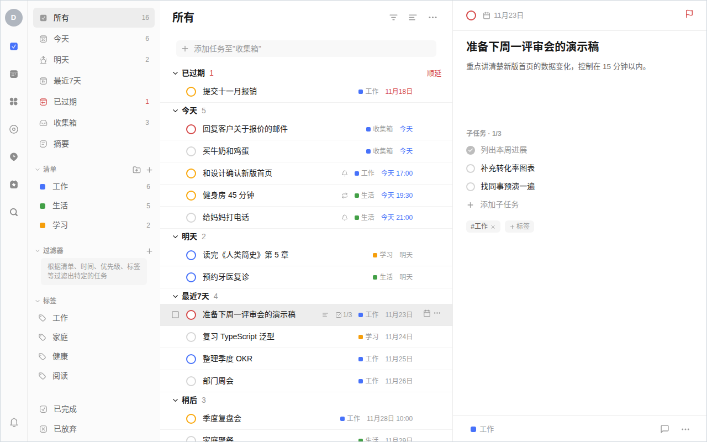
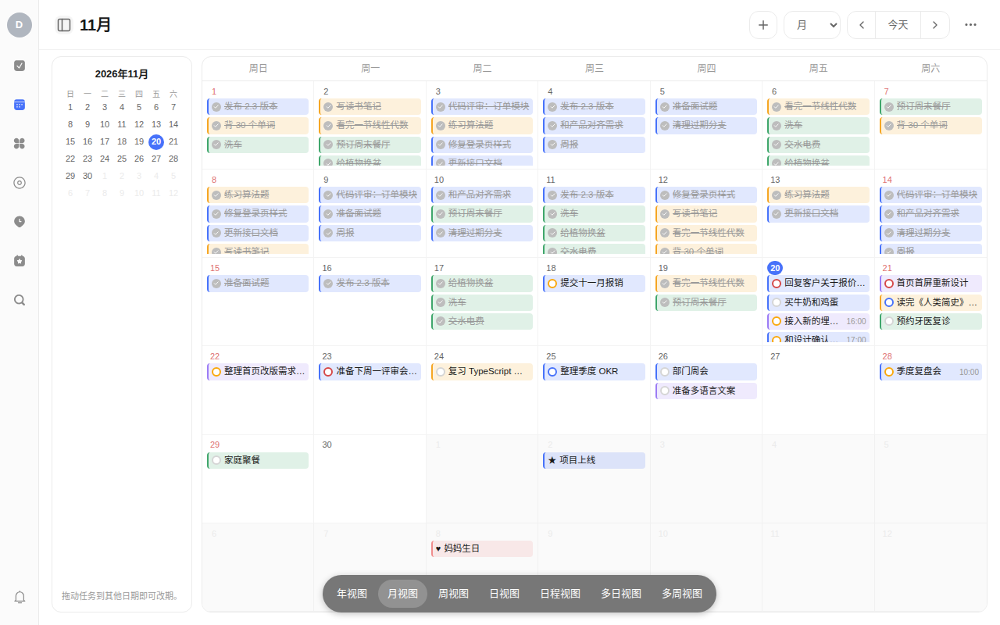
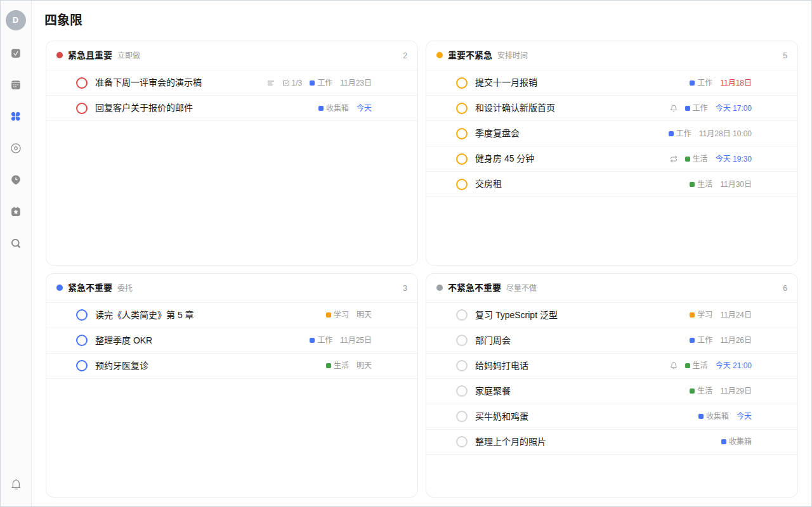
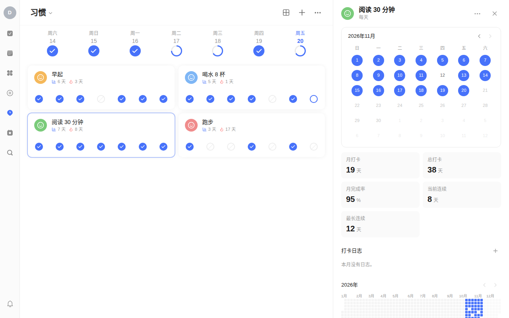
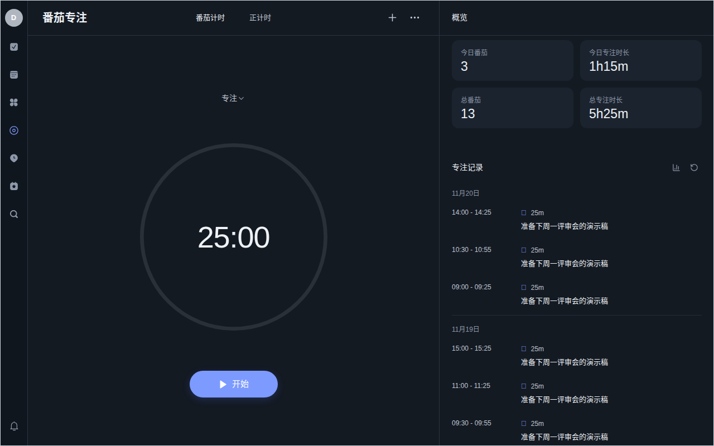
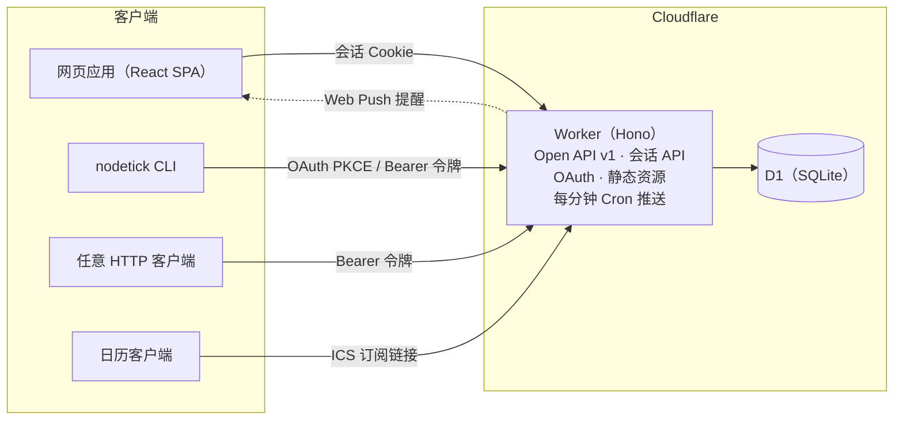

# NodeTick 🐘

中文 | [English](README.en.md)

**跑在 Cloudflare 上的自托管 TickTick 兼容任务服务器，附带网页应用和命令行工具。**

正如 [NodeWarden](https://github.com/shuaiplus/nodewarden) 之于 Bitwarden，NodeTick 之于 TickTick：任务、清单、习惯和专注数据都存放在你自己的 Cloudflare 账号里。

- **兼容 TickTick Open API v1**：实现了官方 [ticktick-cli](https://www.npmjs.com/package/@ticktick/ticktick-cli) 使用的核心端点，另有回收站、倒计时写入等扩展
- **自带网页应用**：TickTick 风格的 React 应用，覆盖任务、日历、四象限、习惯、专注、倒计时和浏览器推送
- **配套 CLI**：`nodetick` 的命令与官方 CLI 对齐，并且可以指定自建服务器
- **零运维**：基于 Workers + D1，不用管服务器和数据库，没有流量费，免费套餐即可运行



[功能](#功能) · [架构](#架构) · [部署](#部署) · [CLI](#cli) · [API](#api) · [安全模型](#安全模型) · [本地开发](#本地开发) · [路线图](#路线图)

## 功能

- **任务**：智能清单（所有 / 今天 / 明天 / 最近 7 天 / 收集箱）、清单与分组、标签、过滤器；列表 / 看板 / 时间线视图（时间线下方列出无日期任务，点开即可设日期），看板列可重命名、删除、列内快速添加；置顶和批量操作；已完成、已放弃与回收站（软删除，可恢复或彻底删除）
- **搜索**：多个关键词同时匹配标题、描述、子任务和标签（`#标签` 只匹配标签），命中处高亮并显示所在的描述或子任务；按清单、标签、日期（今天 / 明天 / 本周 / 最近 7 天 / 本月 / 已过期 / 无日期 / 自定义）、优先级、类型（任务 / 笔记）和状态（未完成 / 已完成 / 已放弃）多选筛选；记住最近搜索；一键把关键词和条件保存为过滤器
- **日历**：年 / 月 / 周 / 日 / 日程 / 3 日 / 2 周视图和迷你月历；拖拽改期，点格子里的 `+` 直接新建带日期的任务
- **四象限**：按优先级把任务分进四个象限
- **习惯**：7 天打卡条和连胜记录
- **专注**：番茄计时器和周统计
- **倒计时**：倒数纪念日，可按月或按年重复；设在 29–31 日的每月重复遇到小月时在月末提醒，2 月 29 日的每年重复在平年按 2 月 28 日提醒
- **摘要**：按条件汇总任务（开发中，见[路线图](#路线图)）
- **通知**：通过 Web Push 推送任务、习惯和纪念日提醒；每台设备单独开关，在一台设备上关闭不影响其他设备；推送文案跟随该设备的界面语言（中 / 英）；支持分类开关、全天事项提醒时间和测试通知，点击通知直达对应任务（需先[开启浏览器通知](#开启浏览器通知可选)）
- **账号与数据**：修改密码；管理员在「用户管理」页添加、删除用户和重置密码；JSON 备份与恢复；从 Microsoft To Do 导入清单和任务（需先[配置 Microsoft 应用](#开启-microsoft-to-do-导入可选)）；日历订阅链接（ICS，可添加到 Google 日历、Apple 日历等）；API 令牌管理
- **通用**：中英双语（跟随浏览器语言，可在头像菜单切换）；蓝 / 紫 / 绿 / 深色主题；可在设置里隐藏不用的功能模块和智能清单；手机等窄屏上，任务页的侧栏收进抽屉，任务详情全屏打开

| 日历 | 四象限 |
| :---: | :---: |
|  |  |
| **习惯** | **专注（深色主题）** |
|  |  |

截图中的任务和习惯均为演示数据。

### 快速添加与常用操作

在快速添加框里可以直接写标签、日期和优先级。识别出的日期会蓝色高亮，点击它或在边界按退格只取消识别，文字保留。在「今天」「明天」「最近 7 天」里添加的任务进入收集箱，并预设对应日期；输入里写了日期则以输入为准。

| 输入 | 效果 |
| --- | --- |
| `#标签` | 添加标签 |
| `今天` `明天` `后天` `下周` `周五` `9月5日` `9/5`（可加 `~` 前缀） | 设置日期；已过去的月日会算到明年。英文界面用 `today`、`tomorrow`、`next week` 和星期名 |
| `!3` `!高` `!high` | 高优先级（`!2` / `!中` 为中，`!1` / `!低` 为低，`!0` / `!无` 为无） |

任务列表里还可以：

- 一键顺延过期任务；鼠标悬停在任务行上即可快速设日期
- 用行菜单复制 / 移动 / 删除，误操作能从提示条撤销
- 在详情面板编辑描述、子任务、标签和评论；任务行会显示提醒、重复、描述角标

## 架构



网页应用和 CLI 调用同一套 `/open/v1/*` 端点，网页端用会话 Cookie 认证，无需配置令牌。Worker 同时托管网页应用的静态资源（带 SPA 回退）；`/api/*`、`/oauth/*`、`/open/v1/*` 始终由 Worker 代码处理。`nodetick auth login` 用到的 OAuth 授权确认页由服务端渲染。

| 目录 | 内容 |
| --- | --- |
| `worker/` | Cloudflare Worker：Open API v1、`/api/*` 会话接口、OAuth PKCE、定时推送（Hono + D1） |
| `webapp/` | React SPA，由 Worker 作为静态资源托管（Vite + Tailwind + zustand） |
| `cli/` | `nodetick` CLI（commander，命令与 ticktick-cli 对齐） |
| `tests/` | E2E 套件：用 CLI 测试真实服务器 |

## 部署

需要一个 Cloudflare 账号（免费套餐即可）、Node.js 22+ 和 pnpm（推荐 `corepack enable pnpm`，会自动使用 `package.json` 里固定的 pnpm 版本）。D1 表结构会在首个请求时自动创建，无需手动建表。

### 用命令行部署（约 2 分钟）

**1. 克隆并安装依赖**

```bash
git clone https://github.com/Windyskr/nodetick.git
cd nodetick
pnpm install
```

**2. 登录 Cloudflare 并部署**

```bash
pnpm --filter worker exec wrangler login
pnpm run deploy     # 先构建网页应用，再部署 Worker 和静态资源
```

`pnpm --filter worker exec wrangler …` 在 `worker/` 目录下运行项目自带的 Wrangler，会自动读取 `worker/wrangler.toml`，下文的 Wrangler 命令都这样写。

首次部署时，Wrangler 会自动创建名为 `nodetick-db` 的 D1 数据库（账号里已有同名数据库则直接使用），不需要填写 `database_id`。

> [!TIP]
> 数据库的位置在创建时确定，之后不能修改；自动创建时放在离执行部署的网络最近的地区。每次查询都要往返一次数据库，离用户远了会明显变慢（东京访问美西的库，每次查询约 130 毫秒）。用户主要在亚洲的话，第一次部署前先手动创建：`pnpm --filter worker exec wrangler d1 create nodetick-db --location apac`（亚太区实际落在香港）。其他取值见 [D1 文档](https://developers.cloudflare.com/d1/configuration/data-location/)。

**3. 设置会话密钥**

```bash
pnpm --filter worker exec wrangler secret put SESSION_SECRET
```

按提示粘贴一个 32 位以上的随机字符串（可以用 `openssl rand -hex 32` 生成）。不设置它就无法注册和登录。Secret 写入后立即生效，不需要重新部署。

**4. 打开应用**

访问 `https://nodetick.<你的子域名>.workers.dev`，第一个注册的用户就是管理员。之后公开注册自动关闭，由管理员在「用户管理」页添加账号，所以部署完成后请立即注册。

> [!NOTE]
> `*.workers.dev` 在部分网络（如中国大陆）无法访问，必要时在 Cloudflare 控制台为 Worker 绑定自定义域名。

### 用 Cloudflare 控制台部署

1. Fork 本仓库，在 Workers & Pages 中导入你的 fork，构建设置如下：
   - Worker 名称：`nodetick`（与 `wrangler.toml` 中的 `name` 一致）
   - 构建命令：`pnpm install`
   - 部署命令：`pnpm run deploy`
2. 首次部署会自动创建 D1 数据库 `nodetick-db`。如果自动创建失败，先在控制台手动创建同名数据库，再重新部署。
3. 部署完成后，在 Worker 的设置里添加 Secret `SESSION_SECRET`（32 位以上随机字符串）。

### 开启浏览器通知（可选）

**1. 生成 VAPID 密钥对**

```bash
pnpm --filter worker generate:vapid
```

**2. 设置公钥和联系方式**

在 Cloudflare 控制台的 Worker 设置里添加变量 `VAPID_PUBLIC_KEY`（输出的公钥）和 `VAPID_SUBJECT`（如 `mailto:admin@example.com`）。也可以写进 `worker/wrangler.toml` 的 `[vars]` 后重新 `pnpm run deploy`：

```toml
[vars]
VAPID_PUBLIC_KEY = "<输出的公钥>"
VAPID_SUBJECT = "mailto:admin@example.com"
```

**3. 私钥只存为 Secret**

```bash
pnpm --filter worker exec wrangler secret put VAPID_PRIVATE_KEY
```

私钥不要写进任何文件或提交到仓库。配置完成后，Cron Trigger 每分钟扫描一次到期的提醒，通过 Web Push 推送到已订阅的浏览器。

### 开启 Microsoft To Do 导入（可选）

Microsoft To Do 没有导出功能，导入通过 Microsoft Graph 读取清单和任务，需要一个 Microsoft Entra 应用注册。登录用设备码方式：网页上显示一个代码，用户到微软的登录页输入。这种方式不需要回调地址，所以一个应用注册可以给多个 NodeTick 部署共用。

**1. 注册应用**

1. 登录 [Microsoft Entra 管理中心](https://entra.microsoft.com)，进入「应用注册」→「新注册」。2024 年 6 月起新应用必须注册在目录（租户）里；只有个人账号、没有目录的，可以先注册 Azure 免费账户，会自带一个默认目录。
2. 名称随意（如 `NodeTick`）；「受支持的帐户类型」选「任何组织目录中的帐户和个人 Microsoft 帐户」；重定向 URI 留空。
3. 在「身份验证」里把「允许公共客户端流」设为「是」并保存。
4. 在「API 权限」里添加 Microsoft Graph 的委托权限 `Tasks.Read`。这个权限用户可以自己同意，不需要管理员授权。

**2. 填入 client ID**

复制应用概述页的「应用程序(客户端) ID」，在 Cloudflare 控制台添加变量 `MS_TODO_CLIENT_ID`，或写进 `worker/wrangler.toml` 的 `[vars]` 后重新 `pnpm run deploy`。client ID 不是密钥，可以公开。

只用个人账号时，可以把 `MS_TODO_TENANT` 设为 `consumers`（应用的帐户类型要包含个人帐户）；只用工作或学校账号时，设为 `organizations` 或租户 ID。部分组织禁止设备码登录。

**3. 导入**

在网页应用的「API 令牌」页（`/app/tokens`），点「备份与恢复」里的「从 Microsoft To Do 导入」，登录后勾选要导入的清单。导入规则：

- 每个清单导入为一个清单，To Do 自带的「任务」清单导入到收集箱；Flagged email（Outlook 标记邮件）清单默认不勾选。
- 步骤导入为子任务；备注、类别（导入为标签）、重要标记（导入为高优先级）、截止日期和重复规则都会带上；已完成的任务默认不导入，可以勾选。
- 截止日期导入为全天任务。提醒在截止当天、或任务没有截止日期时，任务改为提醒时刻的定时任务并准时提醒；提醒在截止日之前时，保留全天任务，按「全天事项提醒时间」换算成提前量。
- 附件和清单分组不导入（Graph 不提供清单分组）。
- 只申请只读权限，不会改动 Microsoft To Do。再次导入只添加新任务，之前导入的任务即使在 NodeTick 里改过或删除到回收站，也不会被覆盖或重复导入。

### 配置项

| 名称 | 类型 | 必填 | 说明 |
| --- | --- | --- | --- |
| `SESSION_SECRET` | Secret | 是 | 32 位以上随机字符串，用于签名会话的 CSRF 令牌 |
| `VAPID_PUBLIC_KEY` | 变量 | 否 | Web Push 公钥 |
| `VAPID_SUBJECT` | 变量 | 否 | 推送发送者的联系方式（`mailto:` 或 `https:`） |
| `VAPID_PRIVATE_KEY` | Secret | 否 | Web Push 私钥 |
| `MS_TODO_CLIENT_ID` | 变量 | 否 | Microsoft Entra 应用的客户端 ID，设置后开启 Microsoft To Do 导入 |
| `MS_TODO_TENANT` | 变量 | 否 | Microsoft 登录的租户：`common`（默认）、`consumers`、`organizations` 或租户 ID |

变量可以在 Cloudflare 控制台的 Worker 设置里添加，立即生效，之后部署也会保留（`wrangler.toml` 开启了 `keep_vars`）；也可以写进 `worker/wrangler.toml` 的 `[vars]`，重新部署后生效，并覆盖控制台里的同名变量。Secret 用 `pnpm --filter worker exec wrangler secret put <名称>` 设置。

## CLI

`@nodetick/cli` 尚未发布到 npm，目前从源码安装：

```bash
pnpm --filter cli build
pnpm add -g ./cli    # 全局提供 nodetick 命令；也可以不安装，直接运行 node cli/dist/index.js
```

`pnpm add -g` 要求 pnpm 的全局 bin 目录在 `PATH` 里，第一次使用前先运行一次 `pnpm setup`。

**登录**

```bash
nodetick auth login --server https://nodetick.example.workers.dev   # 浏览器 OAuth 授权
nodetick auth token <token> --server https://...                    # 无浏览器环境：使用网页应用里创建的令牌
nodetick auth status
```

令牌在网页应用的「API 令牌」页（`/app/tokens`）创建。

**常用命令**

```bash
nodetick project create --name Work
nodetick task create --title "买牛奶" --project <projectId> --tags groceries
nodetick task search 牛奶 --status 0
nodetick habit checkin <habitId> --stamp 20260831 --value 5
nodetick focus list --from "2026-08-01T00:00:00+0000" --to "2026-08-30T23:59:59+0000" --type pomodoro
nodetick countdown create --name "发布日" --date 2026-12-31
nodetick countdown update <countdownId> --date 2027-01-01
nodetick countdown delete <countdownId>

nodetick backup export                    # 全量导出到 nodetick-backup-<今天>.json
nodetick backup export ./my-backup.json   # 指定输出路径
nodetick backup import ./my-backup.json   # 按 id 合并导入，不删除现有数据
```

- 大多数命令支持 `--json`，输出原始 API JSON。
- 服务器地址和令牌保存在 `~/.config/nodetick/config.json`（权限 600）；环境变量 `NODETICK_SERVER` / `NODETICK_TOKEN` 优先，适合 CI。
- 完整参数见 `nodetick --help` 和 `nodetick <命令> --help`。

### 与 ticktick-cli 的兼容性

`nodetick` 的命令与官方 ticktick-cli 对齐，服务器实现了下列命令对应的 Open API v1 端点：

- **任务**：get / create / update / complete / delete / move / completed / filter / search；评论增删查；子任务、父子任务、标签、提醒、重复规则、专注汇总
- **清单**：增删改查、`data`（清单 + 任务 + 看板列）、分组（文件夹）、看板列
- **标签**：list / create（任务上用到的标签自动登记）
- **习惯**：get / list / create / update / checkin（按日期 upsert）/ checkins 范围查询
- **专注**：get / list（时间范围最多 30 天）/ create / delete；支持番茄和正计时两种类型
- **倒计时**：list / create / update / delete（官方只有 list，写入是 NodeTick 扩展）

认证方式也与官方一致：OAuth PKCE（`nodetick auth login`）和手动令牌（`nodetick auth token`）。

以下官方命令暂未实现（对照 ticktick-cli 0.1.16）：preference get；task complete-batch、assign、unassign；project members；tag update、rename、delete；habit section list；focus update；calendar account list、calendar event query。

## API

基础路径为 `{server}/open/v1`，端点对齐 [TickTick Open API v1](https://developer.ticktick.com/api#/openapi)。认证使用 `Authorization: Bearer <ntk_…>`，或网页应用的会话 Cookie。标 ★ 的是 NodeTick 扩展。

<details>
<summary><b>任务</b></summary>

| 方法 | 路径 | 说明 |
| --- | --- | --- |
| GET | `/project/{projectId}/task/{taskId}` | 获取任务 |
| POST | `/task` | 创建任务 |
| POST | `/task/{taskId}` | 更新任务（也可以切换 `status` 0 ↔ 2） |
| POST | `/project/{projectId}/task/{taskId}/complete` | 完成任务 |
| DELETE | `/project/{projectId}/task/{taskId}` | 删除任务（软删除，进入回收站） |
| POST | `/task/move` | 在清单之间移动任务 |
| POST | `/task/completed` | 查询已完成任务 |
| POST | `/task/filter` | 按条件筛选任务 |
| POST | `/task/search` | 全文搜索：每个关键词都要出现在标题、描述、子任务或标签里，`#名称` 只匹配标签 |
| GET | `/project/{projectId}/task/{taskId}/comments` | 评论列表 |
| POST | `/project/{projectId}/task/{taskId}/comment` | 添加评论 |
| DELETE | `/project/{projectId}/task/{taskId}/comment/{commentId}` | 删除评论 |
| GET | `/task/trash` | 回收站列表 ★ |
| POST | `/task/trash/{taskId}/restore` | 从回收站恢复 ★ |
| DELETE | `/task/trash/{taskId}` | 彻底删除 ★ |

</details>

<details>
<summary><b>清单、分组与看板列</b></summary>

| 方法 | 路径 | 说明 |
| --- | --- | --- |
| GET | `/project` | 清单列表（首次调用时自动创建收集箱，`id` 为 `inbox`） |
| POST | `/project` | 创建清单 |
| GET | `/project/{projectId}` | 获取清单 |
| POST | `/project/{projectId}` | 更新清单 |
| DELETE | `/project/{projectId}` | 删除清单 |
| GET | `/project/{projectId}/data` | 清单 + 任务 + 看板列 |
| GET / POST | `/project/group` | 分组列表 / 创建分组 |
| POST / DELETE | `/project/group/{groupId}` | 更新 / 删除分组 |
| GET / POST | `/project/{projectId}/column` | 看板列列表 / 创建看板列 |
| POST | `/project/{projectId}/column/{columnId}` | 更新看板列 |
| DELETE | `/project/{projectId}/column/{columnId}` | 删除看板列 ★ |

</details>

<details>
<summary><b>标签、习惯、专注、倒计时、过滤器</b></summary>

| 方法 | 路径 | 说明 |
| --- | --- | --- |
| GET / POST | `/tag` | 标签列表 / 创建标签 |
| POST / DELETE | `/tag/{tagName}` | 修改（改名、颜色、排序）/ 删除标签 ★ |
| GET / POST | `/habit` | 习惯列表 / 创建习惯 |
| GET / POST | `/habit/{habitId}` | 获取 / 更新习惯 |
| POST | `/habit/{habitId}/checkin` | 打卡（按日期 upsert） |
| GET | `/habit/checkins` | 按日期范围查询打卡 |
| GET / POST | `/habit/{habitId}/records`、`/habit/{habitId}/record` | 查询 / 写入习惯记录 ★ |
| GET | `/focus` | 专注记录列表（时间范围最多 30 天） |
| POST | `/focus` | 创建专注记录 |
| GET / DELETE | `/focus/{focusId}?type=` | 获取 / 删除专注记录 |
| GET | `/countdown` | 倒计时列表 |
| POST | `/countdown` | 创建倒计时 ★ |
| POST / DELETE | `/countdown/{countdownId}` | 更新 / 删除倒计时 ★ |
| GET / POST | `/filter` | 过滤器列表 / 创建过滤器（条件含清单、标签、日期、优先级、状态，以及关键词 `keywords` 和类型 `kinds`）★ |
| POST / DELETE | `/filter/{filterId}` | 更新 / 删除过滤器 ★ |

</details>

<details>
<summary><b>备份与日历订阅 ★</b></summary>

| 方法 | 路径 | 说明 |
| --- | --- | --- |
| GET | `/backup/export` | 导出全量备份（JSON） |
| POST | `/backup/import` | 按 id 合并导入备份（其他用户的数据会被跳过） |
| GET | `/feed.ics?token=<密钥>` | 日历订阅（ICS），用订阅链接里的密钥认证，不需要 Bearer 令牌 |

</details>

<details>
<summary><b>浏览器通知 ★</b></summary>

| 方法 | 路径 | 说明 |
| --- | --- | --- |
| GET | `/notification/config` | 推送公钥和当前通知设置 |
| PUT | `/notification/settings` | 更新通知设置 |
| POST / DELETE | `/notification/subscribe` | 订阅 / 取消订阅当前浏览器（可带 `lang`：`zh` / `en`，推送文案按该设备的语言） |
| POST | `/notification/test` | 发送测试通知 |

</details>

<details>
<summary><b>会话与 OAuth（不在 <code>/open/v1</code> 下）</b></summary>

网页应用使用的会话接口，Cookie 认证：

| 方法 | 路径 | 说明 |
| --- | --- | --- |
| GET | `/api/register/status` | 是否开放注册（还没有用户时开放） |
| POST | `/api/register` | 注册（只有第一个用户可以注册，成为管理员） |
| POST | `/api/login` | 登录 |
| POST | `/api/logout` | 登出 |
| GET | `/api/me` | 当前用户 |
| POST | `/api/password` | 修改密码 |
| GET / POST | `/api/tokens` | 令牌列表 / 创建令牌 |
| POST | `/api/tokens/{tokenId}/revoke` | 吊销令牌 |
| GET / POST | `/api/admin/users` | 用户列表 / 添加用户（仅管理员） |
| DELETE | `/api/admin/users/{id}` | 删除用户及其全部数据（仅管理员） |
| POST | `/api/admin/users/{id}/password` | 重置用户密码（仅管理员） |
| GET / POST | `/api/export`、`/api/import` | 下载备份 / 导入备份 |
| GET | `/api/export/calendar.ics` | 下载 ICS 日历文件 |
| GET / POST | `/api/feed`、`/api/feed/regenerate` | 查看 / 重新生成日历订阅链接（旧链接立即失效） |
| GET | `/api/import/microsoft/config` | 服务器是否配置了 Microsoft 应用 |
| POST | `/api/import/microsoft/device`、`/api/import/microsoft/token` | 开始设备码登录 / 轮询登录结果（转发给 Microsoft） |
| POST | `/api/import/microsoft/tasks` | 导入一个清单的一批任务（Graph 格式，每次最多 200 个，已导入的跳过） |

OAuth（client id 为 `nodetick-cli`）：

| 方法 | 路径 | 说明 |
| --- | --- | --- |
| GET / POST | `/oauth/authorize` | 授权确认页（PKCE S256，只允许 loopback 回调地址） |
| POST | `/oauth/token` | 用授权码换取令牌 |

</details>

**字段约定**以官方 CLI 的用法为准：`status`（0 未完成 / 2 已完成 / -1 已放弃）、`priority`（0 无 / 1 低 / 3 中 / 5 高）、`etag` 乐观锁、提醒 `TRIGGER` 字符串、`RRULE` / `ERULE` 重复规则。提醒和重复规则按原样存储和返回。完成重复任务时按规则生成下一次，支持 `FREQ`（天 / 周 / 月 / 年）、`INTERVAL`、`BYDAY`（含 `2TU`「第二个周二」、`-1FR`「最后一个周五」）、`BYMONTHDAY`（`-1` 为月末）、`BYMONTH`、`BYSETPOS`、`UNTIL` 和 `COUNT`；`COUNT` 是含当前这次在内还剩的次数，每生成一次减一。日期必须是真实存在的日期，格式为 `yyyy-MM-dd`，可带时间和时区（如 `2026-04-07T09:00:00+0800`）；字段类型不对（例如标题传了对象）返回 400。

## 安全模型

- **API 令牌**（`ntk_…`，256 位随机数）只存 SHA-256 哈希，明文只显示一次，可在网页应用中随时吊销。
- **密码**使用 PBKDF2-SHA-256（10 万次迭代，是 Cloudflare 运行时允许的上限），每个密码有独立的 16 字节随机盐；哈希里记录了迭代次数，以后调整参数不影响已有用户。
- **账号**：第一个注册的用户是管理员，之后公开注册关闭，新账号只能由管理员添加。
- **日历订阅链接**带 128 位随机密钥，只能读取有日期的任务；可随时重新生成，旧链接立即失效。
- **Microsoft To Do 导入**只申请只读的 `Tasks.Read` 权限。Worker 只在登录时转发设备码请求，Microsoft 的访问令牌只保存在浏览器内存里，不写入数据库；网页的 CSP 为此只额外放行 `https://graph.microsoft.com`。
- **会话 Cookie** 设置了 HttpOnly、Secure、SameSite=Lax；`/api/*` 的写请求还要求同源（校验 Origin / Referer）。OAuth 授权确认表单使用签名 CSRF 令牌。
- **防暴力破解**：同一 IP 或同一账号连续登录失败 10 次锁定 2 分钟，失败响应固定延时以抑制时序探测；每个 IP 每 15 分钟最多尝试注册 5 次。登录、注册和锁定事件写入审计日志。
- **防护头**：所有响应带 CSP、`X-Frame-Options: DENY` 等安全头，请求体上限 1 MB。
- **信任模型**：单用户信任。任何持有令牌的人都能读写**你的**数据，请保管好令牌。

## 本地开发

先在 `worker/.dev.vars` 写入本地密钥（该文件已被 git 忽略），否则无法注册和登录：

```ini
SESSION_SECRET=<32 位以上随机字符串>
```

需要调试推送时，再加上 `VAPID_PUBLIC_KEY`、`VAPID_PRIVATE_KEY` 和 `VAPID_SUBJECT`。

| 命令 | 作用 |
| --- | --- |
| `pnpm dev` | 启动 Worker（`wrangler dev`，端口 8787，自动创建本地 D1） |
| `pnpm --filter webapp dev` | 启动 Vite（端口 5173），`/api`、`/open/v1`、`/oauth` 代理到 8787 |
| `pnpm test` | 运行 worker 和 webapp 的全部测试 |
| `pnpm --filter worker test` | Worker 集成测试（vitest + @cloudflare/vitest-pool-workers，真实 D1 语义） |
| `pnpm --filter webapp test` | 网页应用的纯逻辑单元测试（快速添加解析、日期、i18n） |
| `pnpm test:e2e` | 用 `nodetick` CLI 测试真实服务器，见 [tests/README.md](tests/README.md) |
| `pnpm build` | 编译 CLI，并构建网页应用到 `webapp/dist` |
| `pnpm type-check` | 对所有 workspace 运行 `tsc` |

`pnpm run deploy` 会先构建网页应用，再部署 Worker 和静态资源。

## 路线图

- [ ] 为专注增加正计时、更完整的累计统计和完整记录历史。
- [ ] 完善倒计时的提醒、重复、备注、样式、归档和显示设置，进一步对齐官方“倒数纪念日”。
- [x] 搜索增加清单、标签、日期、优先级、类型、状态筛选，以及保存为过滤器。
- [ ] 完成摘要持久化，并接通模板、保存、复制和分享功能。
- [ ] 增加习惯自定义重复规则、编辑、多次数值打卡和历史统计。
- [ ] 将任务描述升级为富文本编辑器，支持 `/` 快速插入，进一步对齐 TickTick 编辑体验。
- [ ] 清理剩余英文文案，并补充生产环境下加载、错误、空状态和响应式场景的 E2E 测试。
- [x] 将第一个自然语言日期识别为特殊元素：文字继续保留在快速添加输入框中，显示蓝色识别状态；点击或边界退格只取消识别，不删除文字。
- [x] 日历年 / 月 / 周 / 日 / 日程 / 3日 / 2周视图和时间段排程。
- [x] 增加管理员用户管理（已取消邀请码，改为管理员直接添加用户）。
- [x] 修复专注记录的时间序列化与显示，正确保留本地时区，避免把本地时间标记为 UTC。

## 免责声明

NodeTick 实现的是官方 CLI 所用 TickTick Open API 的*文档化*行为，与 TickTick（Appest Inc.）没有任何关联，请不要把 NodeTick 的问题报给 TickTick。

记得定期备份数据：

```bash
pnpm --filter worker exec wrangler d1 export nodetick-db --remote --output ../nodetick-backup.sql   # 在 worker/ 下执行，备份写到仓库根目录
```

也可以用 `nodetick task filter --json` 等命令导出。

## 许可

[MIT](LICENSE)
